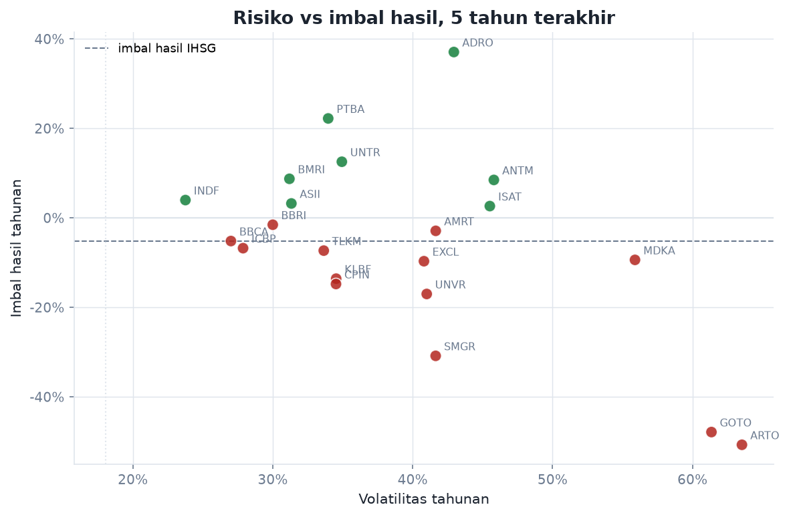
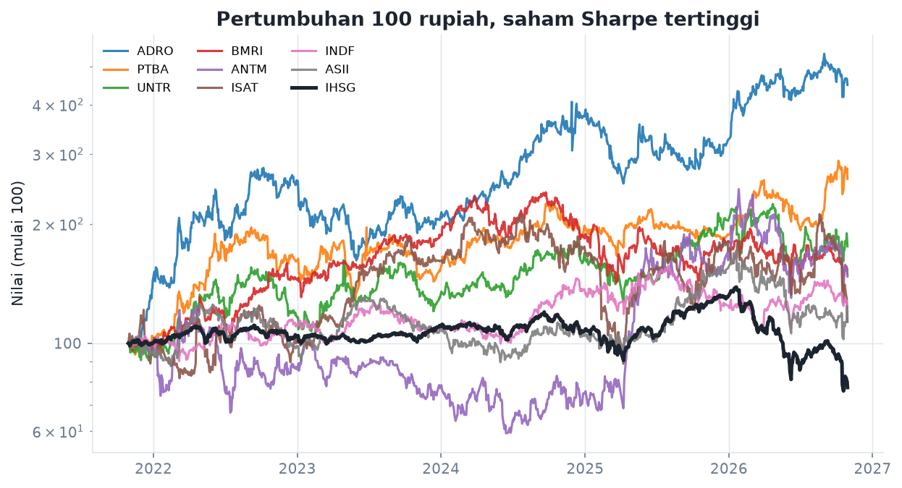
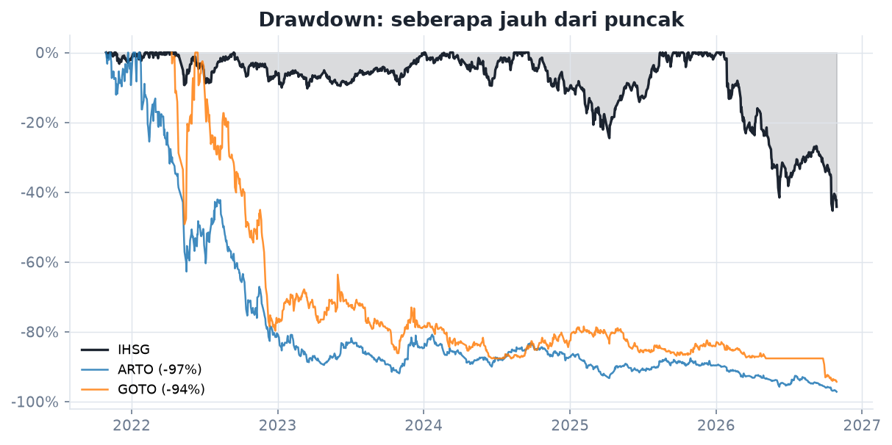
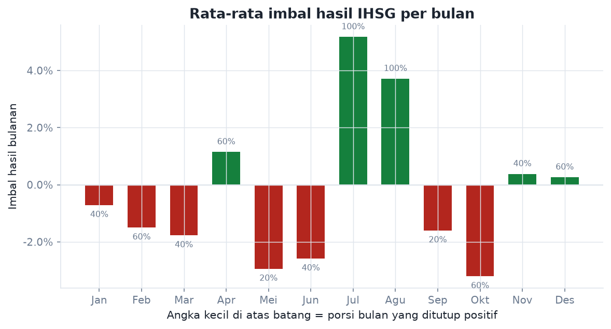

# IHSG dan Saham IDX: Risiko vs Imbal Hasil

Periode 29 Okt 2021 sampai 29 Okt 2026 (1200 hari bursa, 21 saham). Sumber harga: yahoo. Dibuat 2026-10-29 16:56 UTC.

## Posisi IHSG

| Ukuran | Nilai |
|---|---|
| Level terakhir | 5.098.06 |
| Imbal hasil tahunan (CAGR) | -5,3% |
| Imbal hasil tahun berjalan | -41,7% |
| Volatilitas tahunan | 18,1% |
| Drawdown terdalam | -45,3% |
| Posisi sekarang dari puncak | -44,2% |
| Rentang 52 minggu | 4.997 - 9.135 |
| Hari ditutup naik | 52,5% |
| VaR 95% harian | 1,74% |

## Yang paling menonjol

- Sharpe tertinggi: **ADRO** (Adaro Energy), 0.73 dengan imbal hasil tahunan 37.1% dan volatilitas 42.9%.
- Paling sensitif ke IHSG: **ARTO** (beta 1.57). Artinya pergerakan IHSG 1% cenderung diikuti 1.6%.
- Drawdown terdalam paling ringan: **INDF** (-30.8%).
- 16 dari 21 saham punya Sharpe negatif pada periode ini, artinya imbal hasilnya masih di bawah aset bebas risiko.
- IHSG sendiri: -5.3% per tahun dengan volatilitas 18.1% dan drawdown terdalam -45.3%.
- Dalam 1200 hari bursa, 52.5% hari ditutup naik. Hari terburuk 16 Oct 2026 (-11.57%), hari terbaik 09 Jun 2026 (7.57%).

## Metrik per saham

Diurutkan berdasarkan Sharpe. Aset bebas risiko yang dipakai 5,8% per tahun. `VaR 95%` adalah kerugian harian yang terlampaui pada 5% hari terburuk.

| Ticker | Emiten | CAGR 5 th | 1 tahun | Volatilitas | Sharpe | Beta | Max drawdown | VaR 95% | Korelasi IHSG |
|---|---|---|---|---|---|---|---|---|---|
| ADRO | Adaro Energy | 37,1% | 53,6% | 42,9% | 0,73 | 0,86 | -41,6% | 3,65% | 0,36 |
| PTBA | Bukit Asam | 22,2% | 34,6% | 34,0% | 0,49 | 0,71 | -34,2% | 2,75% | 0,38 |
| UNTR | United Tractors | 12,6% | -0,7% | 34,9% | 0,19 | 0,78 | -33,5% | 3,08% | 0,40 |
| BMRI | Bank Mandiri | 8,7% | -1,3% | 31,2% | 0,10 | 1,15 | -44,0% | 2,89% | 0,67 |
| ANTM | Aneka Tambang | 8,5% | -13,4% | 45,8% | 0,06 | 1,09 | -52,2% | 4,23% | 0,43 |
| ISAT | Indosat | 2,6% | -21,0% | 45,5% | -0,07 | 1,01 | -58,0% | 4,03% | 0,40 |
| INDF | Indofood Sukses Makmur | 4,0% | -9,0% | 23,8% | -0,07 | 0,39 | -30,8% | 2,32% | 0,29 |
| ASII | Astra International | 3,2% | -13,3% | 31,3% | -0,08 | 0,87 | -40,2% | 2,77% | 0,50 |
| AMRT | Sumber Alfaria Trijaya | -2,9% | -48,6% | 41,7% | -0,21 | 0,96 | -71,7% | 4,08% | 0,42 |
| BBRI | Bank Rakyat Indonesia | -1,5% | -16,8% | 30,0% | -0,24 | 1,12 | -51,3% | 2,74% | 0,68 |
| MDKA | Merdeka Copper Gold | -9,4% | -18,6% | 55,9% | -0,27 | 1,41 | -81,8% | 5,44% | 0,46 |
| EXCL | XL Axiata | -9,7% | -36,3% | 40,8% | -0,38 | 1,01 | -63,8% | 3,59% | 0,45 |
| TLKM | Telkom Indonesia | -7,3% | -29,6% | 33,6% | -0,39 | 0,99 | -51,9% | 3,02% | 0,53 |
| BBCA | Bank Central Asia | -5,2% | -29,4% | 27,0% | -0,40 | 0,97 | -51,8% | 2,44% | 0,65 |
| ICBP | Indofood CBP | -6,8% | -34,5% | 27,9% | -0,45 | 0,51 | -53,6% | 2,92% | 0,33 |
| UNVR | Unilever Indonesia | -17,0% | -18,2% | 41,0% | -0,55 | 0,73 | -79,3% | 3,60% | 0,32 |
| KLBF | Kalbe Farma | -13,6% | -32,2% | 34,5% | -0,56 | 0,67 | -69,6% | 3,28% | 0,35 |
| CPIN | Charoen Pokphand Indonesia | -14,8% | -42,7% | 34,5% | -0,59 | 0,70 | -58,2% | 3,20% | 0,37 |
| JKSE | IHSG (indeks gabungan) | -5,3% | -38,3% | 18,1% | -0,61 | 1,00 | -45,3% | 1,74% | 1,00 |
| GOTO | GoTo Gojek Tokopedia | -47,9% | -57,4% | 61,4% | -0,87 | 1,11 | -94,3% | 6,18% | 0,34 |
| SMGR | Semen Indonesia | -30,8% | -46,5% | 41,6% | -0,88 | 1,08 | -85,0% | 4,08% | 0,47 |
| ARTO | Bank Jago | -50,7% | -74,5% | 63,5% | -0,89 | 1,57 | -97,2% | 6,40% | 0,45 |

## Musiman IHSG per bulan

| Bulan | Rata-rata | Bulan positif | Jumlah tahun |
|---|---|---|---|
| Jan | -0,71% | 40% | 5 |
| Feb | -1,50% | 60% | 5 |
| Mar | -1,77% | 40% | 5 |
| Apr | 1,15% | 60% | 5 |
| Mei | -2,94% | 20% | 5 |
| Jun | -2,58% | 40% | 5 |
| Jul | 5,18% | 100% | 5 |
| Agu | 3,71% | 100% | 5 |
| Sep | -1,60% | 20% | 5 |
| Okt | -3,20% | 60% | 5 |
| Nov | 0,38% | 40% | 5 |
| Des | 0,26% | 60% | 5 |

## Korelasi harian

Korelasi imbal hasil harian antar saham teratas dan IHSG. Nilai 1 berarti bergerak persis sama.

| | ADRO | AMRT | ANTM | ASII | BBRI | BMRI | INDF | ISAT | PTBA | UNTR | JKSE |
|---|---|---|---|---|---|---|---|---|---|---|---|
| **ADRO** | 1,00 | 0,13 | 0,30 | 0,21 | 0,23 | 0,26 | 0,08 | 0,17 | 0,48 | 0,42 | 0,36 |
| **AMRT** | 0,13 | 1,00 | 0,17 | 0,20 | 0,26 | 0,31 | 0,19 | 0,17 | 0,15 | 0,17 | 0,42 |
| **ANTM** | 0,30 | 0,17 | 1,00 | 0,21 | 0,20 | 0,21 | 0,09 | 0,17 | 0,29 | 0,27 | 0,43 |
| **ASII** | 0,21 | 0,20 | 0,21 | 1,00 | 0,39 | 0,39 | 0,17 | 0,17 | 0,26 | 0,34 | 0,50 |
| **BBRI** | 0,23 | 0,26 | 0,20 | 0,39 | 1,00 | 0,65 | 0,22 | 0,29 | 0,26 | 0,25 | 0,68 |
| **BMRI** | 0,26 | 0,31 | 0,21 | 0,39 | 0,65 | 1,00 | 0,20 | 0,30 | 0,30 | 0,25 | 0,67 |
| **INDF** | 0,08 | 0,19 | 0,09 | 0,17 | 0,22 | 0,20 | 1,00 | 0,12 | 0,10 | 0,12 | 0,29 |
| **ISAT** | 0,17 | 0,17 | 0,17 | 0,17 | 0,29 | 0,30 | 0,12 | 1,00 | 0,17 | 0,14 | 0,40 |
| **PTBA** | 0,48 | 0,15 | 0,29 | 0,26 | 0,26 | 0,30 | 0,10 | 0,17 | 1,00 | 0,43 | 0,38 |
| **UNTR** | 0,42 | 0,17 | 0,27 | 0,34 | 0,25 | 0,25 | 0,12 | 0,14 | 0,43 | 1,00 | 0,40 |
| **JKSE** | 0,36 | 0,42 | 0,43 | 0,50 | 0,68 | 0,67 | 0,29 | 0,40 | 0,38 | 0,40 | 1,00 |

## Gambar

## Catatan metode

- Harga memakai penutupan yang sudah disesuaikan terhadap aksi korporasi (`auto_adjust=True` di Yahoo Finance).
- Imbal hasil tahunan dihitung secara geometrik (CAGR), volatilitas memakai standar deviasi harian dikali akar 252.
- Sharpe dan Sortino memakai aset bebas risiko 5,8% per tahun. Angka ini adalah asumsi, bukan data yang diunduh, dan bisa diubah lewat opsi `--rf`.
- Universe saham dipilih manual dari emiten likuid, jadi **bukan** seluruh bursa dan mengandung survivorship bias. Jangan dibaca sebagai rekomendasi investasi.
- Musiman dihitung dari rata-rata imbal hasil bulanan IHSG sepanjang periode data.
