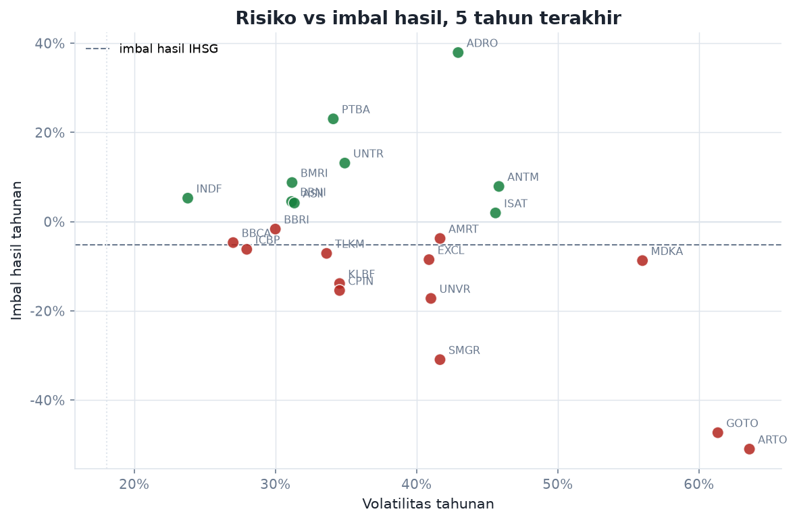
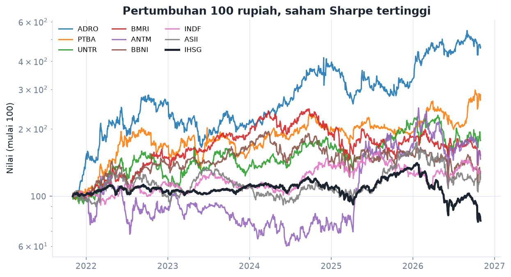
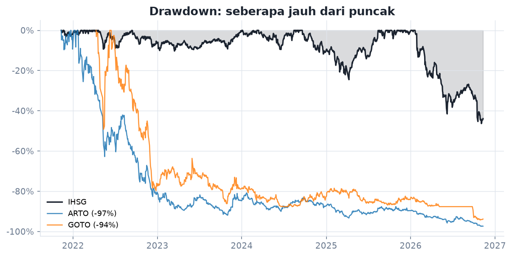
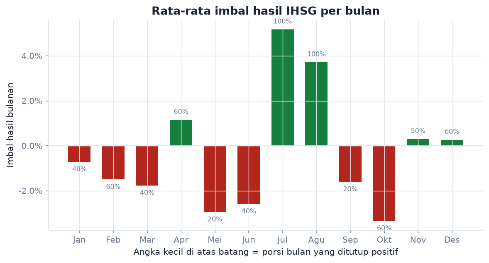

# IHSG dan Saham IDX: Risiko vs Imbal Hasil

Periode 5 Nov 2021 sampai 4 Nov 2026 (1199 hari bursa, 21 saham). Sumber harga: yahoo. Dibuat 2026-11-05 18:02 UTC.

## Posisi IHSG

| Ukuran | Nilai |
|---|---|
| Level terakhir | 4.919.77 |
| Imbal hasil tahunan (CAGR) | -5,9% |
| Imbal hasil tahun berjalan | -43,8% |
| Volatilitas tahunan | 18,2% |
| Drawdown terdalam | -46,3% |
| Posisi sekarang dari puncak | -46,1% |
| Rentang 52 minggu | 4.904 - 9.135 |
| Hari ditutup naik | 52,5% |
| VaR 95% harian | 1,75% |

## Yang paling menonjol

- Sharpe tertinggi: **ADRO** (Adaro Energy), 0.74 dengan imbal hasil tahunan 37.5% dan volatilitas 43.0%.
- Paling sensitif ke IHSG: **ARTO** (beta 1.57). Artinya pergerakan IHSG 1% cenderung diikuti 1.6%.
- Drawdown terdalam paling ringan: **INDF** (-30.8%).
- 16 dari 21 saham punya Sharpe negatif pada periode ini, artinya imbal hasilnya masih di bawah aset bebas risiko.
- IHSG sendiri: -5.9% per tahun dengan volatilitas 18.2% dan drawdown terdalam -46.3%.
- Dalam 1199 hari bursa, 52.5% hari ditutup naik. Hari terburuk 16 Oct 2026 (-11.57%), hari terbaik 09 Jun 2026 (7.57%).

## Metrik per saham

Diurutkan berdasarkan Sharpe. Aset bebas risiko yang dipakai 5,8% per tahun. `VaR 95%` adalah kerugian harian yang terlampaui pada 5% hari terburuk.

| Ticker | Emiten | CAGR 5 th | 1 tahun | Volatilitas | Sharpe | Beta | Max drawdown | VaR 95% | Korelasi IHSG |
|---|---|---|---|---|---|---|---|---|---|
| ADRO | Adaro Energy | 37,5% | 59,1% | 43,0% | 0,74 | 0,87 | -41,6% | 3,67% | 0,37 |
| PTBA | Bukit Asam | 22,2% | 43,0% | 34,1% | 0,48 | 0,71 | -34,2% | 2,80% | 0,38 |
| UNTR | United Tractors | 12,4% | -7,7% | 34,9% | 0,19 | 0,78 | -33,5% | 3,08% | 0,41 |
| BMRI | Bank Mandiri | 8,2% | -0,7% | 31,2% | 0,08 | 1,15 | -44,0% | 2,90% | 0,67 |
| ANTM | Aneka Tambang | 7,7% | -18,7% | 46,1% | 0,04 | 1,10 | -52,2% | 4,26% | 0,43 |
| INDF | Indofood Sukses Makmur | 5,5% | -2,6% | 23,8% | -0,01 | 0,39 | -30,8% | 2,32% | 0,29 |
| ASII | Astra International | 4,6% | -8,6% | 31,4% | -0,04 | 0,86 | -40,2% | 2,78% | 0,50 |
| BBNI | Bank Negara Indonesia | 3,9% | -10,5% | 31,2% | -0,06 | 1,07 | -41,1% | 2,94% | 0,62 |
| ISAT | Indosat | 0,8% | -22,2% | 45,6% | -0,11 | 1,02 | -58,0% | 4,09% | 0,41 |
| AMRT | Sumber Alfaria Trijaya | -4,8% | -59,1% | 41,7% | -0,25 | 0,96 | -74,7% | 4,13% | 0,42 |
| BBRI | Bank Rakyat Indonesia | -2,4% | -15,8% | 30,1% | -0,27 | 1,13 | -51,3% | 2,79% | 0,68 |
| MDKA | Merdeka Copper Gold | -9,8% | -23,0% | 56,1% | -0,28 | 1,42 | -81,8% | 5,52% | 0,46 |
| EXCL | XL Axiata | -9,9% | -34,2% | 41,0% | -0,38 | 1,02 | -65,3% | 3,60% | 0,45 |
| BBCA | Bank Central Asia | -5,1% | -28,5% | 27,1% | -0,40 | 0,97 | -51,8% | 2,45% | 0,65 |
| ICBP | Indofood CBP | -5,6% | -33,4% | 28,1% | -0,40 | 0,52 | -54,5% | 2,92% | 0,33 |
| TLKM | Telkom Indonesia | -8,1% | -30,9% | 33,7% | -0,41 | 0,98 | -51,9% | 3,08% | 0,53 |
| UNVR | Unilever Indonesia | -17,2% | -22,3% | 41,0% | -0,56 | 0,73 | -79,3% | 3,60% | 0,32 |
| KLBF | Kalbe Farma | -13,7% | -37,4% | 34,6% | -0,56 | 0,66 | -69,6% | 3,28% | 0,35 |
| CPIN | Charoen Pokphand Indonesia | -16,4% | -49,0% | 34,6% | -0,64 | 0,70 | -59,4% | 3,26% | 0,37 |
| JKSE | IHSG (indeks gabungan) | -5,9% | -39,4% | 18,2% | -0,64 | 1,00 | -46,3% | 1,75% | 1,00 |
| GOTO | GoTo Gojek Tokopedia | -47,2% | -56,4% | 61,3% | -0,86 | 1,10 | -94,3% | 6,17% | 0,34 |
| ARTO | Bank Jago | -51,3% | -75,8% | 63,6% | -0,90 | 1,57 | -97,4% | 6,40% | 0,45 |

## Musiman IHSG per bulan

| Bulan | Rata-rata | Bulan positif | Jumlah tahun |
|---|---|---|---|
| Jan | -0,71% | 40% | 5 |
| Feb | -1,50% | 60% | 5 |
| Mar | -1,77% | 40% | 5 |
| Apr | 1,15% | 60% | 5 |
| Mei | -2,94% | 20% | 5 |
| Jun | -2,58% | 40% | 5 |
| Jul | 5,18% | 100% | 5 |
| Agu | 3,71% | 100% | 5 |
| Sep | -1,60% | 20% | 5 |
| Okt | -3,34% | 60% | 5 |
| Nov | -0,11% | 33% | 6 |
| Des | 0,26% | 60% | 5 |

## Korelasi harian

Korelasi imbal hasil harian antar saham teratas dan IHSG. Nilai 1 berarti bergerak persis sama.

| | ADRO | AMRT | ANTM | ASII | BBNI | BMRI | INDF | ISAT | PTBA | UNTR | JKSE |
|---|---|---|---|---|---|---|---|---|---|---|---|
| **ADRO** | 1,00 | 0,13 | 0,30 | 0,21 | 0,19 | 0,26 | 0,08 | 0,17 | 0,48 | 0,42 | 0,37 |
| **AMRT** | 0,13 | 1,00 | 0,17 | 0,20 | 0,28 | 0,31 | 0,19 | 0,17 | 0,15 | 0,17 | 0,42 |
| **ANTM** | 0,30 | 0,17 | 1,00 | 0,22 | 0,19 | 0,22 | 0,09 | 0,17 | 0,28 | 0,27 | 0,43 |
| **ASII** | 0,21 | 0,20 | 0,22 | 1,00 | 0,37 | 0,39 | 0,18 | 0,17 | 0,26 | 0,34 | 0,50 |
| **BBNI** | 0,19 | 0,28 | 0,19 | 0,37 | 1,00 | 0,66 | 0,24 | 0,26 | 0,26 | 0,20 | 0,62 |
| **BMRI** | 0,26 | 0,31 | 0,22 | 0,39 | 0,66 | 1,00 | 0,20 | 0,30 | 0,30 | 0,25 | 0,67 |
| **INDF** | 0,08 | 0,19 | 0,09 | 0,18 | 0,24 | 0,20 | 1,00 | 0,12 | 0,10 | 0,12 | 0,29 |
| **ISAT** | 0,17 | 0,17 | 0,17 | 0,17 | 0,26 | 0,30 | 0,12 | 1,00 | 0,16 | 0,14 | 0,41 |
| **PTBA** | 0,48 | 0,15 | 0,28 | 0,26 | 0,26 | 0,30 | 0,10 | 0,16 | 1,00 | 0,43 | 0,38 |
| **UNTR** | 0,42 | 0,17 | 0,27 | 0,34 | 0,20 | 0,25 | 0,12 | 0,14 | 0,43 | 1,00 | 0,41 |
| **JKSE** | 0,37 | 0,42 | 0,43 | 0,50 | 0,62 | 0,67 | 0,29 | 0,41 | 0,38 | 0,41 | 1,00 |

## Gambar

## Catatan metode

- Harga memakai penutupan yang sudah disesuaikan terhadap aksi korporasi (`auto_adjust=True` di Yahoo Finance).
- Imbal hasil tahunan dihitung secara geometrik (CAGR), volatilitas memakai standar deviasi harian dikali akar 252.
- Sharpe dan Sortino memakai aset bebas risiko 5,8% per tahun. Angka ini adalah asumsi, bukan data yang diunduh, dan bisa diubah lewat opsi `--rf`.
- Universe saham dipilih manual dari emiten likuid, jadi **bukan** seluruh bursa dan mengandung survivorship bias. Jangan dibaca sebagai rekomendasi investasi.
- Musiman dihitung dari rata-rata imbal hasil bulanan IHSG sepanjang periode data.
