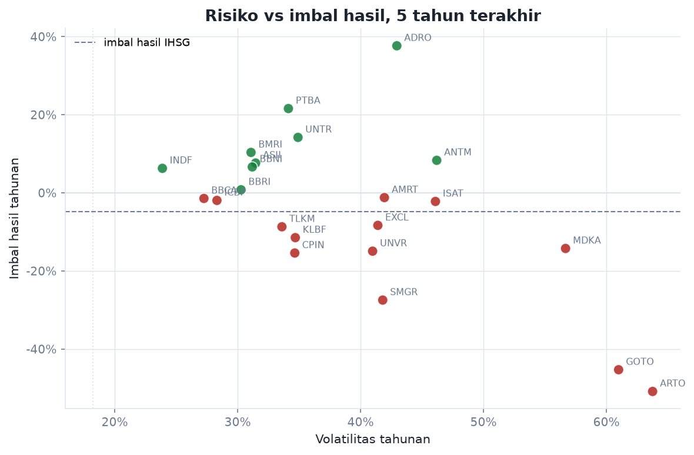
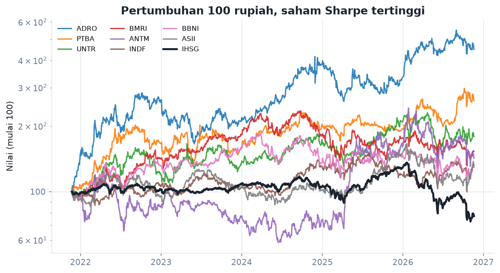
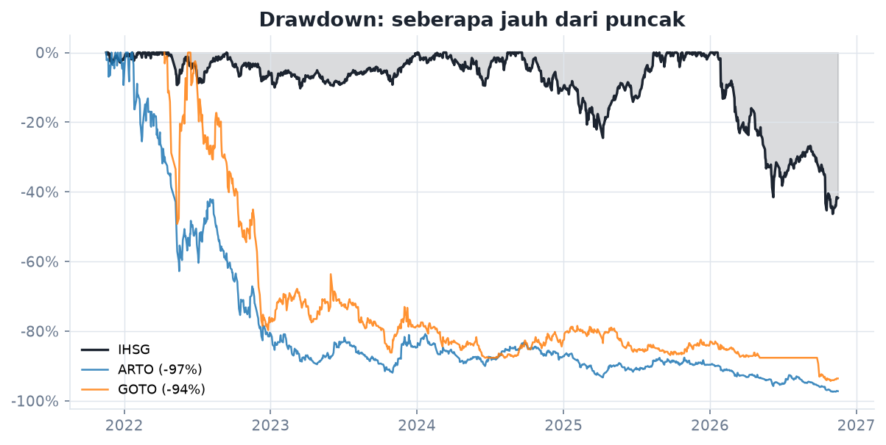
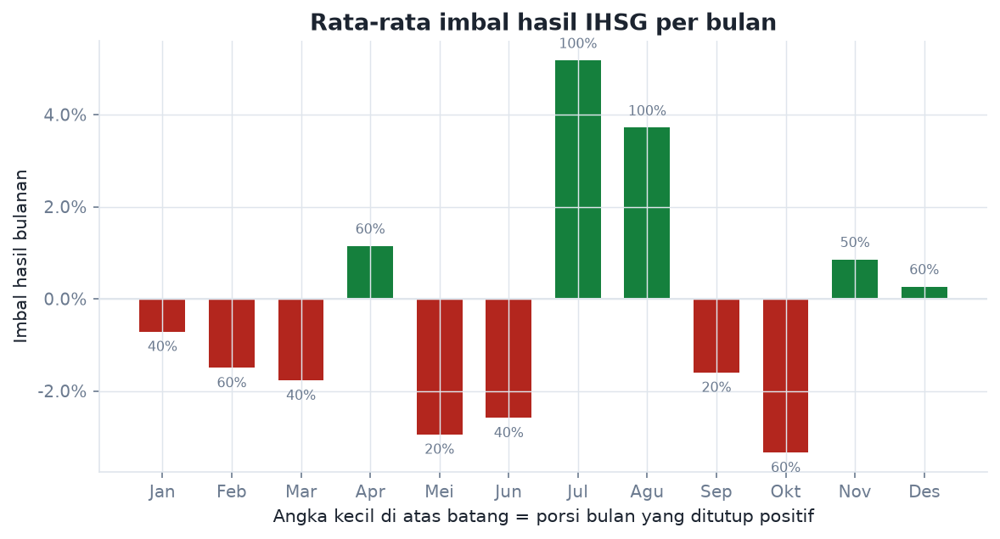

# IHSG dan Saham IDX: Risiko vs Imbal Hasil

Periode 29 Nov 2021 sampai 26 Nov 2026 (1199 hari bursa, 22 saham). Sumber harga: yahoo. Dibuat 2026-11-27 19:29 UTC.

## Posisi IHSG

| Ukuran | Nilai |
|---|---|
| Level terakhir | 5.242.17 |
| Imbal hasil tahunan (CAGR) | -4,8% |
| Imbal hasil tahun berjalan | -40,1% |
| Volatilitas tahunan | 18,2% |
| Drawdown terdalam | -46,3% |
| Posisi sekarang dari puncak | -42,6% |
| Rentang 52 minggu | 4.904 - 9.135 |
| Hari ditutup naik | 52,3% |
| VaR 95% harian | 1,74% |

## Yang paling menonjol

- Sharpe tertinggi: **ADRO** (Adaro Energy), 0.74 dengan imbal hasil tahunan 37.7% dan volatilitas 43.0%.
- Paling sensitif ke IHSG: **ARTO** (beta 1.57). Artinya pergerakan IHSG 1% cenderung diikuti 1.6%.
- Drawdown terdalam paling ringan: **INDF** (-30.8%).
- 14 dari 22 saham punya Sharpe negatif pada periode ini, artinya imbal hasilnya masih di bawah aset bebas risiko.
- IHSG sendiri: -4.8% per tahun dengan volatilitas 18.2% dan drawdown terdalam -46.3%.
- Dalam 1199 hari bursa, 52.3% hari ditutup naik. Hari terburuk 16 Oct 2026 (-11.57%), hari terbaik 09 Jun 2026 (7.57%).

## Metrik per saham

Diurutkan berdasarkan Sharpe. Aset bebas risiko yang dipakai 5,8% per tahun. `VaR 95%` adalah kerugian harian yang terlampaui pada 5% hari terburuk.

| Ticker | Emiten | CAGR 5 th | 1 tahun | Volatilitas | Sharpe | Beta | Max drawdown | VaR 95% | Korelasi IHSG |
|---|---|---|---|---|---|---|---|---|---|
| ADRO | Adaro Energy | 37,7% | 41,7% | 43,0% | 0,74 | 0,86 | -41,6% | 3,63% | 0,37 |
| PTBA | Bukit Asam | 21,6% | 29,6% | 34,1% | 0,46 | 0,70 | -34,2% | 2,76% | 0,37 |
| UNTR | United Tractors | 14,2% | -8,2% | 34,9% | 0,24 | 0,78 | -33,5% | 3,08% | 0,41 |
| BMRI | Bank Mandiri | 10,4% | -5,3% | 31,1% | 0,15 | 1,14 | -44,0% | 2,89% | 0,67 |
| ASII | Astra International | 7,6% | -5,3% | 31,5% | 0,06 | 0,87 | -40,2% | 2,76% | 0,50 |
| ANTM | Aneka Tambang | 8,3% | -2,3% | 46,2% | 0,06 | 1,10 | -52,2% | 4,34% | 0,43 |
| BBNI | Bank Negara Indonesia | 6,6% | -13,6% | 31,2% | 0,03 | 1,06 | -41,1% | 2,86% | 0,62 |
| INDF | Indofood Sukses Makmur | 6,3% | 4,4% | 23,9% | 0,02 | 0,38 | -30,8% | 2,33% | 0,29 |
| BBRI | Bank Rakyat Indonesia | 0,8% | -14,5% | 30,3% | -0,16 | 1,13 | -51,3% | 2,79% | 0,68 |
| AMRT | Sumber Alfaria Trijaya | -1,2% | -42,9% | 41,9% | -0,17 | 0,96 | -74,7% | 4,08% | 0,42 |
| ISAT | Indosat | -2,2% | -35,6% | 46,1% | -0,17 | 1,03 | -58,0% | 4,18% | 0,41 |
| BBCA | Bank Central Asia | -1,4% | -28,0% | 27,3% | -0,26 | 0,97 | -51,8% | 2,45% | 0,65 |
| ICBP | Indofood CBP | -1,9% | -13,6% | 28,3% | -0,27 | 0,52 | -54,5% | 2,92% | 0,34 |
| EXCL | XL Axiata | -8,3% | -34,3% | 41,4% | -0,34 | 0,98 | -67,5% | 3,62% | 0,43 |
| MDKA | Merdeka Copper Gold | -14,2% | -27,3% | 56,7% | -0,35 | 1,44 | -81,8% | 5,58% | 0,46 |
| TLKM | Telkom Indonesia | -8,7% | -37,4% | 33,6% | -0,43 | 0,99 | -51,9% | 3,10% | 0,54 |
| KLBF | Kalbe Farma | -11,5% | -34,6% | 34,7% | -0,50 | 0,66 | -69,6% | 3,28% | 0,35 |
| UNVR | Unilever Indonesia | -14,9% | -27,6% | 41,0% | -0,50 | 0,73 | -79,3% | 3,60% | 0,32 |
| JKSE | IHSG (indeks gabungan) | -4,8% | -37,6% | 18,2% | -0,58 | 1,00 | -46,3% | 1,74% | 1,00 |
| CPIN | Charoen Pokphand Indonesia | -15,4% | -47,9% | 34,6% | -0,61 | 0,70 | -60,7% | 3,20% | 0,37 |
| SMGR | Semen Indonesia | -27,5% | -45,5% | 41,8% | -0,79 | 1,09 | -82,5% | 4,08% | 0,47 |
| GOTO | GoTo Gojek Tokopedia | -45,3% | -55,7% | 61,0% | -0,84 | 1,09 | -94,3% | 6,13% | 0,33 |
| ARTO | Bank Jago | -50,9% | -75,6% | 63,8% | -0,89 | 1,57 | -97,4% | 6,40% | 0,45 |

## Musiman IHSG per bulan

| Bulan | Rata-rata | Bulan positif | Jumlah tahun |
|---|---|---|---|
| Jan | -0,71% | 40% | 5 |
| Feb | -1,50% | 60% | 5 |
| Mar | -1,77% | 40% | 5 |
| Apr | 1,15% | 60% | 5 |
| Mei | -2,94% | 20% | 5 |
| Jun | -2,58% | 40% | 5 |
| Jul | 5,18% | 100% | 5 |
| Agu | 3,71% | 100% | 5 |
| Sep | -1,60% | 20% | 5 |
| Okt | -3,34% | 60% | 5 |
| Nov | 0,88% | 50% | 6 |
| Des | 0,26% | 60% | 5 |

## Korelasi harian

Korelasi imbal hasil harian antar saham teratas dan IHSG. Nilai 1 berarti bergerak persis sama.

| | ADRO | AMRT | ANTM | ASII | BBNI | BBRI | BMRI | INDF | PTBA | UNTR | JKSE |
|---|---|---|---|---|---|---|---|---|---|---|---|
| **ADRO** | 1,00 | 0,13 | 0,30 | 0,21 | 0,19 | 0,23 | 0,26 | 0,08 | 0,48 | 0,42 | 0,37 |
| **AMRT** | 0,13 | 1,00 | 0,17 | 0,19 | 0,28 | 0,27 | 0,30 | 0,18 | 0,15 | 0,17 | 0,42 |
| **ANTM** | 0,30 | 0,17 | 1,00 | 0,21 | 0,19 | 0,20 | 0,21 | 0,09 | 0,28 | 0,27 | 0,43 |
| **ASII** | 0,21 | 0,19 | 0,21 | 1,00 | 0,37 | 0,39 | 0,39 | 0,18 | 0,26 | 0,34 | 0,50 |
| **BBNI** | 0,19 | 0,28 | 0,19 | 0,37 | 1,00 | 0,67 | 0,66 | 0,25 | 0,25 | 0,20 | 0,62 |
| **BBRI** | 0,23 | 0,27 | 0,20 | 0,39 | 0,67 | 1,00 | 0,65 | 0,22 | 0,27 | 0,25 | 0,68 |
| **BMRI** | 0,26 | 0,30 | 0,21 | 0,39 | 0,66 | 0,65 | 1,00 | 0,20 | 0,30 | 0,26 | 0,67 |
| **INDF** | 0,08 | 0,18 | 0,09 | 0,18 | 0,25 | 0,22 | 0,20 | 1,00 | 0,10 | 0,12 | 0,29 |
| **PTBA** | 0,48 | 0,15 | 0,28 | 0,26 | 0,25 | 0,27 | 0,30 | 0,10 | 1,00 | 0,43 | 0,37 |
| **UNTR** | 0,42 | 0,17 | 0,27 | 0,34 | 0,20 | 0,25 | 0,26 | 0,12 | 0,43 | 1,00 | 0,41 |
| **JKSE** | 0,37 | 0,42 | 0,43 | 0,50 | 0,62 | 0,68 | 0,67 | 0,29 | 0,37 | 0,41 | 1,00 |

## Gambar

## Catatan metode

- Harga memakai penutupan yang sudah disesuaikan terhadap aksi korporasi (`auto_adjust=True` di Yahoo Finance).
- Imbal hasil tahunan dihitung secara geometrik (CAGR), volatilitas memakai standar deviasi harian dikali akar 252.
- Sharpe dan Sortino memakai aset bebas risiko 5,8% per tahun. Angka ini adalah asumsi, bukan data yang diunduh, dan bisa diubah lewat opsi `--rf`.
- Universe saham dipilih manual dari emiten likuid, jadi **bukan** seluruh bursa dan mengandung survivorship bias. Jangan dibaca sebagai rekomendasi investasi.
- Musiman dihitung dari rata-rata imbal hasil bulanan IHSG sepanjang periode data.
